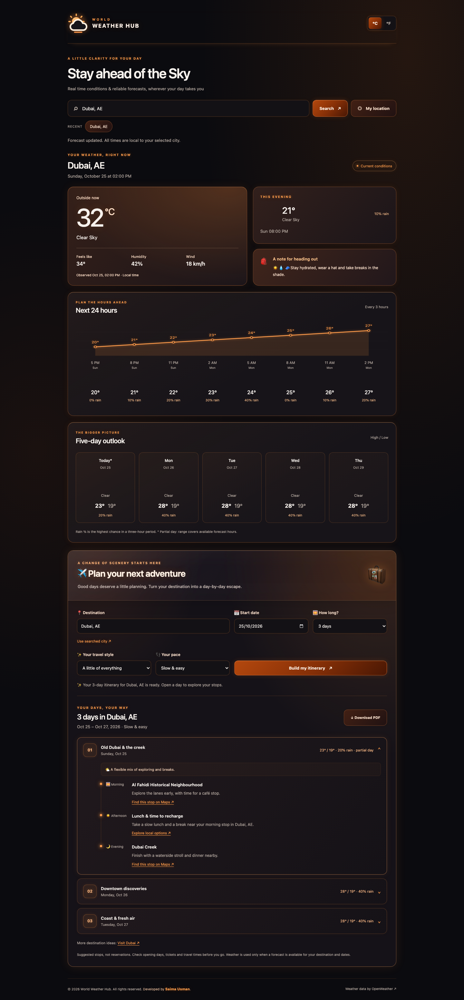

# World Weather Hub

A responsive Flask weather dashboard with current observations, a three-hour temperature trend, eight upcoming forecast periods, and a five-day outlook. Includes city autocomplete, opt-in geolocation, Celsius/Fahrenheit, recent cities, and a destination itinerary planner in an orange-neon-and-black theme with frosted-glass panels and a matching SVG weather logo.

## Preview

Screenshots use mocked weather data for layout verification; they are not live observations.



[View the mobile dashboard](docs/dashboard-mobile.png) · [View the trip planner](docs/trip-planner.png)

## Important: replace the exposed credential

An OpenWeather key was committed in an earlier revision. Revoke that key in your OpenWeather account and create a replacement. The local `.env` has been cleared and removed from Git tracking; `.env.example` contains no credential. Old commits still contain the previous key. Removing a file from tracking does not remove it from repository history, and history cleanup is not a substitute for revocation. No history was rewritten by this update.

## Run locally

Requires Python 3.10+ and an OpenWeather key with access to Current Weather, 5 Day / 3 Hour Forecast, and Direct Geocoding.

```sh
python3 -m venv .venv
source .venv/bin/activate
pip install -r requirements.txt
cp .env.example .env
# Edit .env and set OWM_KEY to a newly generated key.
python app.py
```

Open http://127.0.0.1:5000. The page works without a key, but weather requests return a configuration error until one is provided. Geolocation requires localhost or HTTPS and your explicit permission. Location access is requested only when you click **My location**.

## Weather and time semantics

- Current conditions use `/data/2.5/weather`; the forecast is fetched separately.
- All display times use the selected location's UTC offset, independent of your browser timezone. Provider offsets are fixed snapshots; a forecast spanning a daylight-saving transition may need an IANA timezone integration for transition-aware times.
- The evening/morning outlook selects the next available three-hour period at or after local 18:00 or 06:00. These are clock-based periods, not calculated sunrise/sunset.
- The five-day view groups forecast periods by local calendar date. The first day can be partial; an asterisk marks any day with fewer than eight periods. Highs/lows cover available periods and rain percentage is the maximum three-hour probability, not a whole-day probability.
- Temperature charts have exact values in the accompanying forecast cells for screen-reader access. Unit changes do not make another API request.
- Recent cities and unit preferences are stored in localStorage. They can be cleared through browser site settings. Coordinates are sent to this server and OpenWeather to retrieve conditions; this app does not persist coordinates on the server.

## Trip planner

Choose a destination, start date, 1–5 days, travel interests, and an easy or full pace. The planner follows your selected weather location, and can also be used independently when weather is unavailable. Download plans as PDF documents with clickable map links. PDF generation runs on the server without contacting the weather provider; no text-file export is offered.

- Dubai, London (GB), and Tokyo have editorial routes based on the linked official tourism guides. Other destinations use explicitly labelled map searches to help you pick actual venues.
- An interest changes the order of day themes; an easy pace adds a lunch/rest break.
- Weather is matched by destination and calendar date. Rain/snow/storms move outdoor stops indoors; hot days include heat guidance. Dates outside the available forecast stay labelled as having no forecast.
- These are suggested stops, not live schedules, bookings, verified routes, or turn-by-turn directions. Check opening days, admission and travel times yourself. No booking or AI service is contacted to generate a plan.
- Trip plans stay in the page until you leave or refresh; only the existing recent-city and unit preferences use localStorage. When exporting, the itinerary is sent to the server to generate an in-memory PDF; the server does not save the file.

## Production

Use environment variables for secrets and a production WSGI server behind HTTPS:

```sh
gunicorn --bind 127.0.0.1:8000 --workers 2 --threads 4 --timeout 60 app:app
```

Or use Docker (the image excludes `.env`):

```sh
docker build -t weather-hub .
docker run --rm -p 8000:8000 --env-file .env weather-hub
```

`GET /health` reports process availability without contacting OpenWeather; it does not verify credentials or provider availability. Debug mode is disabled. The container runs as a non-root user and emits access/error logs to stdout/stderr. Do not enable request-body or upstream URL logging, which can expose credentials or location data.

For a public service, configure rate limiting at your reverse proxy and consider a short-lived shared weather cache to control provider usage. This version does not add a database, user accounts, or distributed cache.

## Deploy with Vercel (recommended)

GitHub Pages serves static files and cannot run this application's Flask weather endpoints or PDF generator. Vercel supports the Flask `app.py` entrypoint as a Python function. The repository includes `vercel.json`, Python 3.12 configuration, and an asset build that puts browser files at `public/static` for the CDN. Local development keeps using Flask's `static/` folder.

1. Import this GitHub repository into Vercel and choose **Flask** with the repository root as the root directory.
2. Add `OWM_KEY` as a sensitive environment variable in Vercel for Production and Preview. Use a working replacement key; do not paste it into source code, build settings, or GitHub variables.
3. Deploy, then check `/health`, a city search, and **Download PDF**. A successful `/health` response only verifies the app process; it does not verify the provider key.

For deployments gated by GitHub CI:

1. Create/link a Vercel project and copy its organization/project IDs.
2. Create a GitHub **production environment** with a required reviewer and a deployment-branch restriction for `main`. Store the least-privilege `VERCEL_TOKEN` as an environment secret. Configure it directly in GitHub; never paste tokens into chat or source code.
3. Add repository **Actions variables** `VERCEL_ORG_ID` and `VERCEL_PROJECT_ID`, then enable `VERCEL_DEPLOY_ENABLED=true` after the environment protection is configured.
4. Use the workflow to stage a production build without assigning live domains. Test that staged deployment, then promote it from Vercel. Tokens are scoped to authentication steps and are not passed on command lines.
5. Use this as the production deployment path. Disable Vercel's automatic Git production deployments if you want GitHub CI to be the gate for every production release; otherwise Git integration can deploy independently of this workflow.

Pushes to `main` then run the test suite and container build before staging the verified Vercel build. Promotion is a separate release step after verification. Deployment stays skipped until explicitly enabled and configured; CI still runs on pushes and pull requests. Production settings are pulled from Vercel, and `.env` files are excluded from uploads.

Official references: [Flask on Vercel](https://vercel.com/docs/frameworks/backend/flask), [GitHub Pages hosting](https://docs.github.com/en/pages/getting-started-with-github-pages/what-is-github-pages).

## Checks

```sh
pip install -r requirements-dev.txt
python -m unittest discover -s tests -v
node --check static/js/app.js
node --check static/js/trip-planner.js
node --test tests/test_trip_planner.cjs
```

Tests mock the provider and use a frozen clock; they do not need or send an API key. They cover input validation, provider errors, timezones, current/forecast separation, aggregation, and startup routes. GitHub Actions runs these checks, verifies that `.env` is untracked, and builds the container.

## API

- `POST /get_weather`: JSON `{ "location": "Dubai, AE" }` or `{ "lat": 25.2, "lon": 55.3 }`.
- `POST /download_itinerary`: JSON `{ "plan": <generated itinerary>, "unit": "c" }`; downloads a PDF attachment.
- `GET /autocomplete?query=Du`: up to five city matches with coordinates.
- Errors use JSON `{ "error": "..." }` with 400 (input), 404 (city), 502 (provider response), 503 (configuration/quota), or 504 (provider timeout).

Data attribution: [OpenWeather](https://openweathermap.org/).
